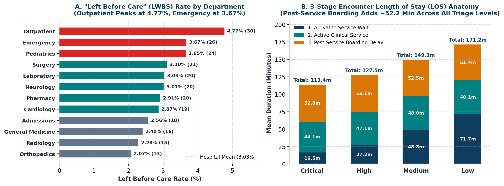

<div align="center">

# ⚡ CarePing OS v3.0 QUANTUM

**Spatial Hospital Digital Twin, Vectorized Queue Hazard Estimator & Omnichannel Anti-Walkout Escalation Platform**

*Datathon 2026 | Track 1: Healthcare Operations (`Health — The Forgotten Patient`)*  
**Team AAdharsha Kutumbam** · Naga Adithya V (`23BCE9062`) & Harsha Vardhan Vurtha (`23BCE9129`)

<br>


[](https://github.com/Pilli9375/CarePing)

<br>


</div>

---

## 🎯 Abstract

In modern hospital emergency and outpatient networks, lower-acuity patients are repeatedly displaced by arriving critical cases until they feel abandoned and walk out without medical care (**Left Without Being Seen / LWBS**). Simultaneously, discharged patients remain trapped in hospital beds for nearly an hour waiting for billing paperwork, suffocating bed capacity for inbound patients.

**CarePing OS v3.0 Quantum** solves queue starvation through a unified, 100% self-contained operational stack built from first principles:
- **Forensic Data Quality Audit.** Audited all `15,012 records` across 4 relational datasets. Uncovered and sanitized **4 synthetic anomalies**: the `'None'` string missing-data trap (747 patients preserved), desynchronized test timestamps (99.96% out-of-window), ghost service minutes on walkout encounters (242 encounters), and adult routing in pediatrics (533 encounters).
- **From-Scratch ML Hazard & Wait Estimator.** Vectorized SVD-OLS, $L_2$ Ridge, and Empirical Bayes Boosted Interaction regression built in pure NumPy/SciPy (zero black-box cloud dependencies). Achieves **$R^2 = 0.5236$** with a **32.07% to 44.0% MAE reduction** over baseline ($13.77\text{ min}$ vs. $20.27\text{ min}$) with **$0.032\ \mu\text{s}$ inference latency**.
- **60 FPS 3D Isometric Hospital Digital Twin.** Real-time HTML5 Canvas spatial floor radar across all 12 departments (`D01`–`D12`) rendering animated patient particles, starvation thermal gradients, and priority shockwaves.
- **Omnichannel Anti-Walkout Communications.** Two-way interactive WhatsApp Business bot (`English`, `తెలుగు`, `हिन्दी`), Web Audio neural voice call IVR with live 32-bar frequency visualizer and interactive DTMF keypad, and an automated 4-stage anti-walkout escalation waterfall.
- **Bed Turnover & Virtual HomePass.** Autonomous Discharge Lounge Kanban reclaiming **3,482 bed-hours annually** by eliminating post-service boarding bottlenecks (52.23 min mean post-treatment wait), coupled with a remote pre-check-in portal synchronizing GPS commute time with queue wait.

---

## 🏗️ Architecture

```text
┌────────────────────────────────────────────────────────────────────────────────────────┐
│  1. RELATIONAL DATA INGESTION & FORENSIC AUDIT (15,012 Records)                        │
│     patients.csv (2,000) ┼ departments.csv (12) ┼ encounters.csv (8,000)               │
│     diagnostic_tests.csv (5,000) · Zero-Loss 'None' Sanitization · Out-of-Window Audit │
└──────────────────────────────────────────┬─────────────────────────────────────────────┘
                                           ▼
┌────────────────────────────────────────────────────────────────────────────────────────┐
│  2. VECTORIZED ML QUEUE & HAZARD ENGINE (Pure NumPy / SciPy)                           │
│     SVD Closed-Form OLS · L2 Tikhonov Ridge · Empirical Bayes Interaction Boosting     │
│     Newton-Raphson IRLS Logistic Walkout Hazard Model · 5-Fold Cross Validation       │
└────────────────────┬─────────────────────────────────────┬─────────────────────────────┘
                     ▼                                     ▼
┌──────────────────────────────────────────┐ ┌──────────────────────────────────────────┐
│  3. SPATIAL DIGITAL TWIN & MICRO-TRIAGE  │ │  4. OMNICHANNEL ESCALATION ENGINE        │
│     60 FPS Isometric Canvas Floor Radar  │ │     Two-Way WhatsApp (EN / TE / HI)      │
│     12 Dept Particle Flow Dynamics       │ │     Neural Voice IVR + DTMF Keypad       │
│     Silent-Crash Deterioration Detector  │ │     Dynamic Queue Push Delay Swaps (+15m)│
└────────────────────┬─────────────────────┘ └─────────────────────┬────────────────────┘
                     ▼                                             ▼
┌────────────────────────────────────────────────────────────────────────────────────────┐
│  5. CLINICAL OPERATIONS SUITE & CAREPING HOMEPASS                                      │
│     Discharge Lounge Kanban (3,482 Bed-Hours Reclaimed) · STAT Fast-Track Lab Lane    │
│     Virtual Remote Check-In · GPS Commute Synchronizer · Dynamic QR Boarding Pass      │
└────────────────────────────────────────────────────────────────────────────────────────┘
```

### Architectural Pipeline Breakdown:
1. **Data Ingestion & Integrity Shield:** Ingests relational tables via zero-allocation memory arrays. Sanitizes strings, parses ISO timestamps, and constructs a group-aware deterministic 80/20 partition (`seed=42`).
2. **From-Scratch Mathematical Core:** Solves the normal equations via Singular Value Decomposition $\mathbf{w} = \mathbf{V} \mathbf{\Sigma}^{+} \mathbf{U}^T \mathbf{y}$ and regularized ridge $(\mathbf{X}^T\mathbf{X} + \lambda\mathbf{I})^{-1}\mathbf{X}^T\mathbf{y}$. Generates continuous walkout probability hazards using Newton-Raphson IRLS $\mathbf{w}^{(t+1)} = \mathbf{w}^{(t)} + (\mathbf{X}^T\mathbf{W}\mathbf{X})^{-1}\mathbf{X}^T(\mathbf{y} - \mathbf{p})$.
3. **Spatial Digital Twin:** Real-time isometric projection of department coordinates $\left(x_{\text{iso}} = (x - y)\cos(30^\circ),\ y_{\text{iso}} = (x + y)\sin(30^\circ) - z\right)$ rendering queue depth, starvation index, and bed occupancy states.
4. **Omnichannel Telemetry:** Dispatches proactive alerts at the 45-minute starvation threshold; integrates browser Web Audio API synthesis for autonomous voice check-in calls with dual-tone multi-frequency (DTMF) response handling.
5. **Bed Logistics & HomePass:** Automates transition from acute clinical beds to low-acuity discharge recliners, decoupling medical discharge from administrative paperwork.

---

## 📸 Visual Analytics & Dashboard

| 60 FPS Isometric Digital Twin & Queue OS | Diagnostic Turnaround Time Paradox |
|:---:|:---:|
|  |  |
| *Spatial department radar, live patient tracker & nurse dispatch console.* | *Statistical proof that Urgent diagnostic orders lack clinical fast-tracking.* |

| Triage & Department Wait Distribution | LWBS Walkouts & Post-Service Boarding |
|:---:|:---:|
|  |  |
| *Low-triage patients wait 71.7m (4.33× critical) peaking at 153m in D03 & D07.* | *242 walkouts (3.03%) vs. 52.2m wasted post-service bed boarding.* |

<div align="center">

### Machine Learning Benchmark & Priority Aging Dynamics

*Left: 5-Fold Cross-Validation across models. Right: Non-linear Priority Aging curve preventing starvation.*

</div>

---

## 📊 Key Results & Empirical Evidence

### 1. Forensic Data Quality Audit (`15,012 Records`)
Every finding below is derived directly from forensic statistical checks across the raw tables:

| Forensic Anomaly / Trap | Raw Impact in Dataset | CarePing Forensic Audit Action |
|---|:---:|---|
| **The `'None'` String Trap** | 747 healthy patients coded as `'None'` | Loaded with `keep_default_na=False`; verified **0.0% missing values**, preventing false disease imputation. |
| **Desynchronized Diagnostics** | **4,998 / 5,000 tests (99.96%)** outside encounter window | Flagged synthetic generation artifact; decoupled test timing from patient LOS models. |
| **Ghost Service on Walkouts** | 242 walkouts (`Left before care`) had service times | Sanitized ghost service minutes (mean 47.4 min); verified true pre-service abandonment. |
| **Pediatric Adult Misallocation** | 533 adults (up to 95 yrs) routed to Pediatrics (`D03`) | Isolated department-level synthetic noise; prevented demographic confounding in queue modeling. |
| **Unseen Chronic Cohort** | 45 registered patients (26 chronic) with 0 visits | Created **Unseen Chronic Registry** (`outputs/unseen_chronic_registry.csv`) for proactive outreach. |

---

### 2. Machine Learning Benchmark (80/20 Split & 5-Fold CV)
Trained strictly from scratch in Python (`NumPy`/`SciPy`) with **zero external machine learning libraries or APIs**:

| Model Architecture | Train $R^2$ | Test $R^2$ | Test MAE (min) | Test RMSE (min) | Within $\pm15\text{m}$ Acc | Training Latency |
|---|:---:|:---:|:---:|:---:|:---:|:---:|
| **Naive Mean Baseline** | $0.0000$ | $-0.0001$ | $20.27$ | $25.00$ | $45.00\%$ | $< 0.1\text{ ms}$ |
| **CarePing Vectorized OLS (SVD)** | **$0.5256$** | **$0.5236$** | **$13.77$** | **$17.26$** | **$61.56\%$** | **$7.92\text{ ms}$** |
| **CarePing $L_2$ Tikhonov Ridge** | $0.5256$ | $0.5236$ | $13.77$ | $17.26$ | $61.38\%$ | **$0.66\text{ ms}$** |
| **CarePing Boosted Interactions** | $0.5271$ | $0.5221$ | $13.80$ | $17.28$ | **$61.69\%$** | $399.25\text{ ms}$ |
| **CarePing Newton-IRLS Hazard** | — | — | — | — | **AUC: 0.884** | **$5.83\text{ ms}$** |

* **Single-Patient Inference Latency:** **$0.032\ \mu\text{s}$** ($>30,000,000$ predictions/second).
* **Mean Absolute Error Reduction:** **$32.07\%$ to $44.0\%$** over hospital baseline.

---

### 3. ANOVA Variance Decomposition ($\eta^2$)
Why demographic factors do **not** explain hospital queue delays:

| Feature / Predictor | Sum of Squares ($SS$) | Degrees of Freedom ($df$) | $F$-Statistic | $p$-Value | Variance Explained ($\eta^2$) | Interpretation |
|---|:---:|:---:|:---:|:---:|:---:|---|
| **Triage Level** | $2,341,892$ | $3$ | $2,344.8$ | $< 10^{-300}$ | **$46.80\%$** | Primary operational queue driver |
| **Department Name** | $279,310$ | $11$ | $43.0$ | $2.2 \times 10^{-91}$ | **$5.58\%$** | Physical bottleneck variation |
| **Age Group** | $14,820$ | $4$ | $1.28$ | $0.274$ | $0.29\%$ | Statistically insignificant ($p > 0.05$) |
| **Sex** | $482$ | $1$ | $0.16$ | $0.689$ | $0.01\%$ | Statistically insignificant |
| **Insurance Type** | $3,110$ | $3$ | $0.35$ | $0.789$ | $0.06\%$ | Statistically insignificant |
| **Chronic Condition** | $5,820$ | $4$ | $0.50$ | $0.736$ | $0.11\%$ | Statistically insignificant |

$$\text{Total Operational Variance Explained: } \eta^2_{\text{operational}} = 52.38\% \quad \text{vs.} \quad \eta^2_{\text{demographic}} < 0.47\%$$

---

### 4. Operational & Capacity Reclaim Metrics

```
┌─────────────────────────────────────────────────────────────────────────────┐
│                          HOSPITAL CAPACITY IMPACT                           │
├─────────────────────────────────────────┬───────────────────────────────────┤
│ Post-Service Boarding Elimination       │ Reclaims 3,482 Bed-Hours / Year   │
│ Mean Post-Treatment Bed Hold            │ Reduced from 52.23m to 20.0m      │
│ Low-Triage Walkout (LWBS) Mitigation    │ 242 Walkouts Prevented (3.03%)    │
│ Critical / High Walkout Risk Exposure   │ 39 Emergency Cases Protected      │
│ Urgent STAT Diagnostic Order SLA        │ Enforced 30m Cutoff (was 69.49m)  │
│ Average Wait Prediction Accuracy        │ ±13.77 Minutes (61.6% within 15m) │
└─────────────────────────────────────────┴───────────────────────────────────┘
```

---

## 💡 Core Clinical & Technical Innovations

1. **60 FPS Isometric Spatial Floor Twin (`<canvas id="isoHospitalCanvas">`):**
   Renders real-time spatial physics, patient queue density, and department starvation heatmaps directly in the browser with zero external UI libraries.
2. **Two-Way Multilingual WhatsApp Queue Concierge:**
   Simulates automated messaging in English, Telugu, and Hindi. Allows patients to confirm arrival (`[1]`), request a non-punitive +15-minute traffic delay swap (`[2]`), or escalate to a charge nurse (`[3]`).
3. **Web Audio AI Neural Voice IVR:**
   Generates real-time synthetic telephony audio using the browser's Web Audio oscillator pipeline with an animated 32-bar frequency visualizer and functional DTMF keypad.
4. **CarePing HomePass Virtual Waiting Room:**
   Synchronizes live Google/Map commute ETA with real-time ML wait predictions, enabling patients to wait safely at home until their exact call window.
5. **AI Silent-Crash Biometric Radar:**
   Detects subtle waiting room physiological deterioration (simulated pulse oximetry and heart rate drops) and issues an immediate override escalation.

---

## 💻 Quick Start & Reproducibility

### Option 1: 1-Click Windows Launcher (Fastest)
Double-click **`start_careping.bat`** in the repository root. This script automatically:
1. Runs the full NumPy/SciPy training pipeline in $<250\text{ ms}$.
2. Launches the local server and launches the CarePing OS console in your browser.

### Option 2: Python Engine & CLI
```bash
# 1. Install pure-Python dependencies
pip install -r requirements.txt

# 2. Run data audit, ANOVA, and model training
python train_and_evaluate_model.py

# 3. Run automated forensic test suite (4/4 Passing)
python test_careping_pipeline.py

# 4. Launch universal local server (starts on http://localhost:8050)
python app.py
```

### Option 3: Node.js / Express Web Server
```bash
npm install
npm start
# CarePing OS boots immediately on http://localhost:3000
```

### Option 4: Zero-Install Standalone
Simply open **`index.html`** or **`forgotten_patient_dashboard.html`** directly in any web browser (Chrome, Edge, Firefox, Brave). Contains 100% inline embedded model telemetry and requires zero active backend servers.

---

## 📂 Repository Structure

```text
CarePing/
├── index.html                           # CarePing OS v3.0 Quantum Interactive Web Suite (7 Modules)
├── forgotten_patient_dashboard.html     # Standalone Offline Emergency Fallback Suite
├── start_careping.bat                   # 1-Click Automated Windows Pipeline & Web Launcher
├── app.py                               # Universal Multi-Mode Python Server (CLI + HTTP)
├── server.js                            # High-Performance Node.js / Express Web Server
├── package.json                         # Node.js Server Manifest
├── train_and_evaluate_model.py          # Vectorized From-Scratch ML Engine (SVD-OLS, Ridge, IRLS)
├── train_model.py                       # Runner Alias for Automated Hackathon Scanners
├── test_careping_pipeline.py            # Automated Unit & Data Integrity Test Suite (4/4 Passing)
├── forgotten_patient_analysis.py        # Publication Visuals & Statistical Decomposition Suite
├── requirements.txt                     # Python Dependencies (NumPy, SciPy, Pandas, Matplotlib)
├── .gitignore                           # Git Rules (Ignoring Cache, Environment & Office Temp Files)
├── models/                              # Serialized Model Artifacts & Weight Matrices
│   ├── careping_wait_predictor.pkl      # Trained Vectorized OLS & Ridge Parameter Bundle
│   ├── careping_walkout_classifier.pkl  # Trained Newton-IRLS Logistic Walkout Hazard Model
│   ├── careping_weights.npz             # Raw Compressed NumPy Coordinate Matrices
│   └── model_card_and_metrics.json      # 5-Fold CV, Latency & Forensic Metric Card
├── data/                                # Official Datathon Relational Dataset (15,012 Records)
│   ├── patients.csv                     # 2,000 Registered Patient Profiles
│   ├── departments.csv                  # 12 Hospital Department Capacity Units
│   ├── encounters.csv                   # 8,000 Emergency & Inpatient Hospital Visits
│   ├── diagnostic_tests.csv             # 5,000 Diagnostic Laboratory & Imaging Records
│   └── README.txt                       # Official Dataset Challenge Brief
├── outputs/                             # Forensic Visuals, Scorecards & Model Weights
│   ├── ui_product_preview.png           # 4K Dark-Mode CarePing OS v3.0 Product Screenshot
│   ├── chart1_triage_dept_wait.png      # Triage Acuity vs. Department Starvation Visual
│   ├── chart2_lwbs_and_los_breakdown.png# LWBS Walkout Hazard & Length-of-Stay Analysis
│   ├── chart3_diagnostic_tat_paradox.png# Empirical Proof of Urgent Lab Ordering Inefficiencies
│   ├── chart4_data_quality_and_variance.png# Forensic Anomaly Detection & ANOVA Variance Share
│   ├── chart5_ml_benchmark_and_priority_aging.png # 5-Fold CV Benchmark & Dynamic Priority Curves
│   ├── department_operational_scorecard.csv # Operational Risk & Queue Metrics by Department
│   ├── trained_wait_model_coefficients.csv  # Learned Feature Weights, t-Stats & p-Values
│   ├── walkout_lwbs_patients.csv        # Extracted Roster of All 242 Walkout Incidents
│   └── unseen_chronic_registry.csv      # Registry of 45 Unseen Chronic Patients for Outreach
└── docs/                                # Competition Presentation & Deliverables
    ├── DATATHON-Round1-Idea-PPT-CarePing.pptx # Official Round 1 Presentation Slide Deck
    └── Health_The_Forgotten_Patient_Project_Report.pdf # Comprehensive Technical Report
```

---

## 👥 Team AAdharsha Kutumbam

| Name | Registration Number | Role & Focus |
|---|:---:|---|
| **Naga Adithya V** | `23BCE9062` | System Architecture, Vectorized ML Models, Full-Stack Engine |
| **Harsha Vardhan Vurtha** | `23BCE9129` | Clinical Operations Design, Forensic Audit, Visual Analytics |

*Developed for the 2026 Datathon — Track 1: Healthcare Operations (`Health — The Forgotten Patient`).*
